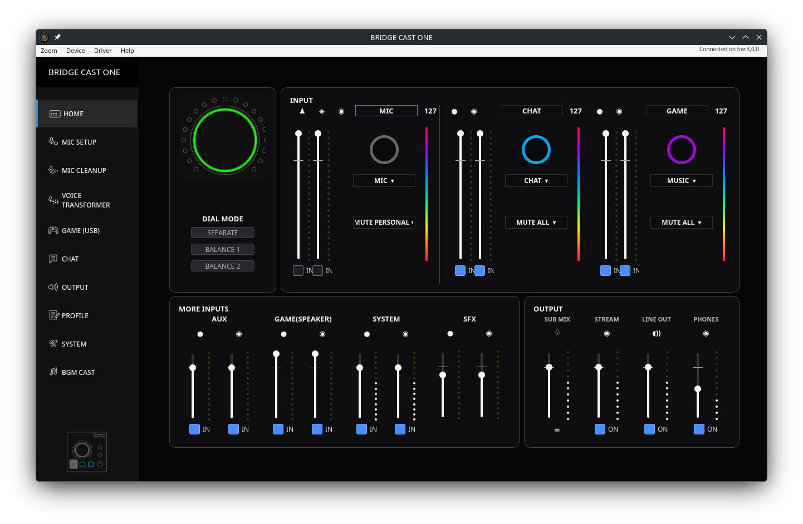

# BRIDGE CAST ONE for Linux

[](https://github.com/mthorson/bridgecast-one-linux/actions/workflows/ci.yml)

An unofficial Linux controller for the Roland BRIDGE CAST ONE audio mixer. The current release is **[v0.1.0 (preview)](https://github.com/mthorson/bridgecast-one-linux/releases/tag/v0.1.0)**. It reads the device's mixer state, shows live level meters, and exposes the controls listed below.



## Requirements

- A BRIDGE CAST ONE connected by USB, with its hardware switch set to **PC**
- Linux, Python 3.10 or newer, and PyQt6
- ALSA utilities (`amidi`) and the `libasound` shared library
- Permission to access the device's ALSA MIDI port

The app uses the device's APP MIDI port and does not need Roland's Windows or macOS USB driver. It detects the port after USB reconnects, even if the ALSA card number changes.

## Install and run

The [v0.1.0 release](https://github.com/mthorson/bridgecast-one-linux/releases/tag/v0.1.0) includes two Linux downloads:

- **CachyOS / Arch Linux:** install `bridgecast-one-linux-0.1.0-1-any.pkg.tar.zst` with `sudo pacman -U ./bridgecast-one-linux-0.1.0-1-any.pkg.tar.zst`. Pacman handles the Python, PyQt6, and ALSA package dependencies.
- **Other distributions:** install Python 3 with PyQt6, ALSA utilities, and `libasound` using your distribution's package manager. Extract `bridgecast-one-linux-0.1.0-linux.tar.gz` and run `./install.sh` inside the extracted folder. This copies the app into your user data directory and adds a desktop launcher without root privileges.

To run directly from this repository instead:

```sh
python3 -m venv .venv
. .venv/bin/activate
python -m pip install -r requirements.txt
python bridgecast_gui.py
```

If PyQt6 is already installed for your system Python, you can run `python3 bridgecast_gui.py` directly. To choose a specific APP MIDI port, pass `--port hw:CARD,DEVICE,SUBDEVICE`. Use `python3 bridgecast_gui.py --version` to check the app version.

## Current controls

| Area | Available now |
| --- | --- |
| Home | Stream Mix and Personal Mix channel levels and mutes; live dotted input and output meters |
| Output | LINE OUT level and source mode; Stream, Phones, and LINE OUT enable controls |
| Mic setup | XLR and headset gain; source and phantom power readouts |
| Mic cleanup | Low cut, noise suppression, de-esser, compressor, and manual EQ enable controls |
| Device menu | Refresh, reconnect, and **Stop mic monitoring** |

The app reads the current settings on connection and checks device readback after a change. The meter display requests a read-only level bank every 40 ms; actual updates can be slower when a request is still in flight.

**Stop mic monitoring** disables the mic in both device mixes while leaving USB mic capture available to applications. Turning either mic mix back on can send the mic to speakers and cause loud feedback, so the app asks before enabling it.

## Preview limitations

- Source assignment boxes, dial modes, other navigation pages, and some output faders are visual or read-only until their BRIDGE CAST ONE commands are verified.
- The HOME source labels follow the reference device setup and may differ from another device's assignments.
- Input meter positions were inferred from the active System channel. Individual channel and output meter mappings still need signal-by-signal validation.
- Profiles, advanced EQ bands, voice effects, SFX transfer, firmware updates, and full hardware button setup are not implemented.
- MIC-only LINE OUT mode is deliberately unavailable because it can create speaker feedback. The app does not flash firmware or factory reset the device.

## Troubleshooting and development

If the app cannot find the device, check the PC switch, reconnect USB, and run `amidi -l`. Look for `BRIDGE CAST ONE MIDI 1`. If a write times out after reconnecting USB, use **Device → Reconnect**. Close other applications using the APP MIDI port if replies are lost.

Run the protocol checks with:

```sh
python3 -m unittest -q test_bridgecast_protocol.py
```

See [CHANGELOG.md](CHANGELOG.md) for the release scope.

Both release downloads are built from the `v0.1.0` tag with `bash packaging/build-release.sh`. The installer lives in `packaging/install.sh`; the Arch package template is in `packaging/arch/`.

## Automation

GitHub Actions runs the protocol tests and loads the GUI offscreen with Python 3.10 and 3.14 on pushes and pull requests. For a new release, update `APP_VERSION` in `bridgecast_qt.py`, this README, and the changelog, then push a matching `vX.Y.Z` tag. The release workflow tests the tagged app, builds both Linux downloads, and attaches them to the GitHub release. It can also be run manually for an existing tag.

## Artwork and ownership

`assets/bridgecast-linux-icon.png` is the custom icon for this controller. The other graphics in `assets/` were extracted from software supplied by Roland with the device. BRIDGE CAST and Roland are trademarks of Roland Corporation. This project is not affiliated with Roland. No software license has been selected for this repository.
